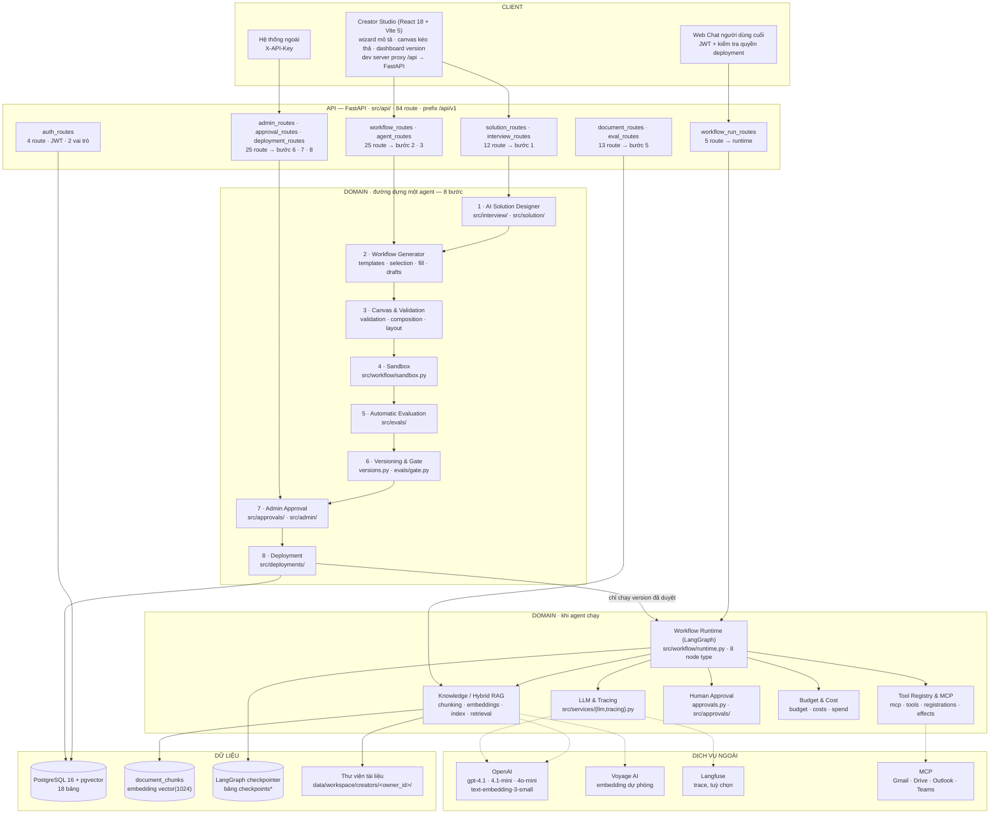
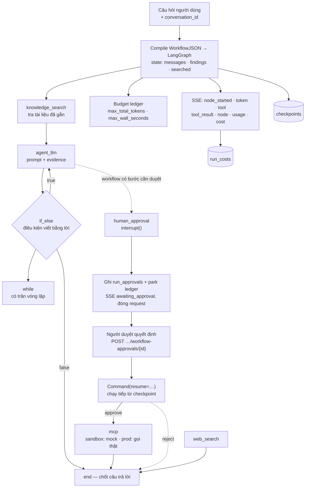
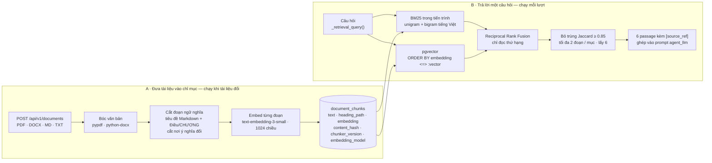

# Architecture Diagram — Agent Builder by Natural Languages

Sơ đồ kiến trúc của hệ thống **thật**, đọc ra từ code trong `src/` chứ không phải
từ template.

## Cách đưa vào draw.io

Có hai đường, dùng đường nào cũng ra cùng nội dung.

**Cách 1 — mở thẳng file `.drawio` (khuyến nghị).**
File [`docs/architecture.drawio`](architecture.drawio) là file draw.io gốc, 4 trang,
đã có sẵn màu và bố cục.

- Trên [app.diagrams.net](https://app.diagrams.net): `File → Open From → Device`
  rồi chọn file.
- Trong VS Code: cài extension *Draw.io Integration* rồi mở file như file thường.
- Sinh lại file này: `python scripts/gen_architecture.py`.

**Cách 2 — dán code Mermaid ở dưới.**
Trong draw.io: `Arrange → Insert → Advanced → Mermaid`, dán một khối ```mermaid```
bên dưới vào, bấm *Insert*. Mỗi khối là một sơ đồ riêng.

---

## 1. Components — hệ thống có những gì



## 2. Data flow — dựng một agent

Trạng thái in đậm là giá trị `AgentVersion.status` sau mỗi bước; đó là thứ chặn
không cho bỏ qua bước nào.

```mermaid
flowchart LR
    A["Nhân viên mô tả bài toán<br/>bằng ngôn ngữ tự nhiên"]
    B["POST /solution-interviews<br/>trích 7 slot, phát hiện thiếu / mâu thuẫn"]
    C["POST …/answers<br/>hỏi từng câu tới khi đủ"]
    D["POST …/spec<br/><b>spec_pending_confirmation</b>"]
    E["Người tạo rà 7 trường<br/>PUT solution-spec — gắn ref tài liệu"]
    F["POST …/solution-spec/confirmation<br/><b>spec_confirmed</b>"]
    G["POST …/workflow<br/>chọn 1 trong 8 template + AI điền cấu hình<br/><b>workflow_pending_confirmation</b>"]
    H["Canvas: kéo thả / sửa bằng lời<br/>PUT …/workflow · POST …/workflow/refine"]
    I["POST …/workflow/confirm<br/><b>workflow_confirmed</b>"]
    J["POST …/workflow-sandbox-runs<br/>tool có side effect dùng mock<br/><b>sandbox_passed</b>"]
    K["POST …/workflow-eval-cases/generate<br/>sinh case từ success_criteria + prohibitions"]
    L["POST …/workflow-eval-runs<br/>rule-based check + LLM judge"]
    M{"pass_rate ≥ threshold?"}
    N["POST …/approval-request<br/><b>pending_review</b>"]
    O["Admin đọc hồ sơ duyệt<br/>GET /admin/approvals/{version_id}"]
    P["POST /admin/approvals/{id}/approve<br/><b>approved</b>"]
    Q["PUT /agents/{id}/deployed-version"]
    R["Deployment active<br/>web chat · api key · rate limit"]

    A --> B --> C --> D --> E --> F --> G --> H --> I --> J --> K --> L --> M
    M -->|đạt| N --> O --> P --> Q --> R
    M -.->|không đạt — sửa rồi eval lại| H
    H -.->|chưa ưng — sinh lại| G
```



## 3. Data flow — runtime một lượt chạy



## 4. Data flow — Hybrid RAG (ADR-0045)



Chỉ mục tự vô hiệu khi **một trong ba** thứ đổi: hash nội dung tệp,
`CHUNKER_VERSION`, hoặc tên model embedding — vector của hai model khác nhau
không so sánh được với nhau, kể cả gần đúng.

---

## Bảng thành phần

| Thành phần | Công nghệ | Vị trí trong repo | Nhiệm vụ |
|---|---|---|---|
| Creator Studio | React 18 + Vite 5 | `frontend/` | Wizard mô tả, canvas kéo thả, dashboard version. Dev server proxy `/api` sang FastAPI nên trình duyệt không gọi thẳng backend — không dính CORS |
| API | FastAPI + Uvicorn | `src/api/` (84 route) | REST + SSE, xác thực, phân quyền |
| Xác thực | JWT HS256 | `src/auth/` | 2 vai trò: `creator`, `admin` |
| AI Solution Designer | LangChain + GPT | `src/interview/`, `src/solution/` | Mô tả tự nhiên → spec 7 trường |
| Workflow Generator | Template + LLM fill | `src/workflow/{templates,selection,fill,drafts}.py` | Chọn 1 trong 8 template rồi điền cấu hình |
| Validation | Thuần Python | `src/workflow/validation.py` | Kiểm tra đồ thị, trả `problems[]` |
| Workflow Runtime | LangGraph | `src/workflow/runtime.py` | 8 node type, state, condition, pause/resume |
| Knowledge / RAG | BM25 + pgvector | `src/workflow/{chunking,embeddings,index,retrieval,knowledge}.py` | Hybrid retrieval trên PDF/DOCX |
| Tool Registry | MCP | `src/workflow/{mcp,tools,registrations,effects}.py` | Risk level, credential, mock sandbox |
| Sandbox | LangGraph + mock | `src/workflow/sandbox.py` | Chạy thử, ghi transcript từng bước |
| Automatic Evaluation | Rule + LLM judge | `src/evals/` | Sinh case từ spec, chấm, chặn deploy |
| Human Approval | LangGraph `interrupt()` | `src/workflow/approvals.py`, `src/approvals/` | Dừng giữa chừng, chờ người, chạy tiếp |
| Budget & Cost | Thuần Python | `src/agents/{budget,costs,spend}.py` | Trần token/thời gian, ghi chi phí thật |
| Deployment | FastAPI + API key | `src/deployments/` | Publish, rate limit, quyền truy cập |
| CSDL | PostgreSQL 16 + pgvector | `alembic/`, `src/db/models.py` | 18 bảng |
| Checkpointer | LangGraph Postgres | bảng `checkpoints*` | State của thread, nền của pause/resume |
| Trace | Langfuse (tuỳ chọn) | `src/services/tracing.py` | Thiếu key vẫn chạy, chỉ mất trace |

## 8 node type của canvas

| Node | Có side effect | Ghi chú |
|---|---|---|
| `agent_llm` | không | Gọi model, có thể stream token |
| `knowledge_search` | không | Hybrid RAG, chạy thật cả trong sandbox |
| `web_search` | không | Read-only, chạy thật cả trong sandbox |
| `mcp` | **có** | Sandbox dùng mock; prod cần tool đã được duyệt |
| `if_else` | không | Điều kiện viết bằng ngôn ngữ tự nhiên |
| `while` | không | Có trần vòng lặp, transcript ghi rõ khi chạm trần |
| `human_approval` | không | `interrupt()` → `run_approvals` → `Command(resume=…)` |
| `end` | không | Chốt câu trả lời của một nhánh |

## Quyết định kiến trúc đáng chú ý

| Quyết định | Chọn gì | Vì sao |
|---|---|---|
| CSDL | PostgreSQL, **không** SQLite | LangGraph checkpointer chỉ chạy Postgres (issue #3) |
| Vector store | pgvector, **không** ChromaDB | Vector nằm cùng transaction với chunk; một CSDL thay vì hai |
| Sinh workflow | Template + LLM điền | Để LLM tự do sinh đồ thị thì không kiểm tra được, cũng không lặp lại được |
| Ghép 2 ranker | RRF, **không** tổng có trọng số | Điểm BM25 và cosine không cùng thang; RRF chỉ đọc thứ hạng nên không cần chỉnh trọng số |
| Pause/resume | LangGraph `interrupt()` + bảng riêng | Một lượt duyệt kéo dài hơn một HTTP request |
| Quyền tài liệu | Một hàm `knowledge.resolved()` | Chống path traversal và ranh giới giữa creator là **cùng một** quy tắc |
